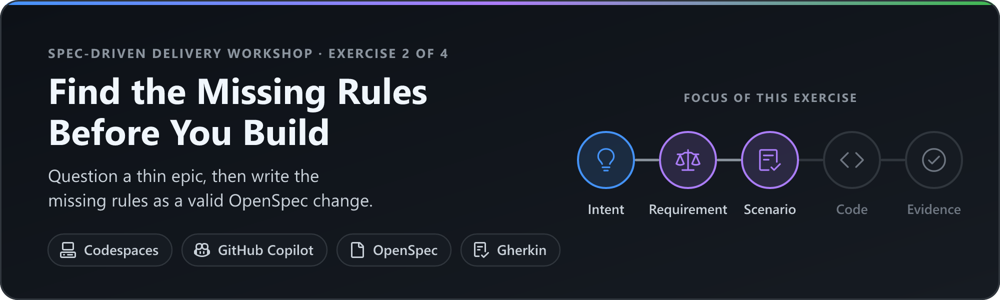
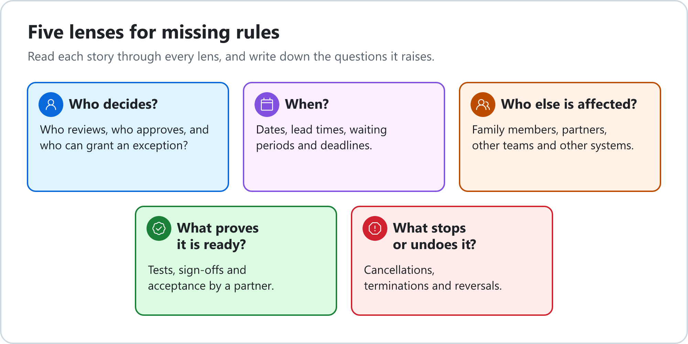
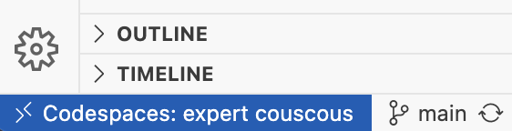
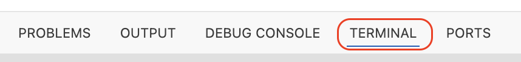
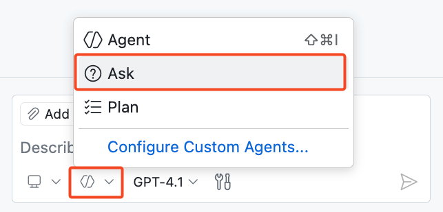

## Step 1: Question the epic



Welcome to the Contoso Health Plan delivery team, @{{ login }}! :wave: In 2025, the team built a vision rider for employer groups from a five-story epic. Eight rules surfaced late, most of them in acceptance testing or after go-live. Your team starts a similar rider next quarter, so first you'll replay the 2025 epic: which questions would have found the missing rules before anyone built anything?

### 📖 Theory: Where missing rules hide

A user story names who wants what and why, but it rarely states the **rules**: the decisions a system and its people must follow, such as who approves, by when, and what happens when something goes wrong. Missing rules hide in five places, so read every story through five lenses. A question asked before build is the cheapest way to find a rule. The same rule found in acceptance testing or after go-live costs rework, and sometimes member calls.



### ⌨️ Activity 1: Open your codespace

Your copy of this repository comes with a ready-made [codespace](https://docs.github.com/en/codespaces/overview): an online editor with Node.js and the OpenSpec command-line tool already installed.

1. Right-click the button below and open it in a new tab, so you can keep these instructions open.

   [](https://codespaces.new/{{ full_repo_name }}?quickstart=1)

1. On the codespace page, check that the repository is `{{ full_repo_name }}`, your copy, and not the original exercise. Then select **Create new codespace**. If you already have a codespace for this repository, the page offers **Resume this codespace** instead; that works too.

1. Wait for the editor to open. The first start takes about 2 to 4 minutes, because the codespace installs everything this exercise needs before it opens.

   > ⏳ **Wait:** You are ready when the bottom-left corner of the editor shows **Codespaces** followed by your codespace's name, and the epic, `retro/original-epic.md`, is open.

   

1. Open a terminal with `` Ctrl+` `` (`` ⌃` `` on Mac), or from the menu (☰) at the top left with **Terminal** > **New Terminal**. Then create a branch for your work.

   > 
   >
   > ```bash
   > git switch -c vision-retro
   > ```

<details>
<summary>Having trouble? 🤷</summary><br/>

- **No terminal is visible:** In the panel at the bottom of the editor, select the **TERMINAL** tab. If there is no panel, press `` Ctrl+` `` (`` ⌃` `` on Mac).

  

- **The codespace opened the original exercise:** Close that tab and use the button above, which points to your copy. You can also start one from your repository page: **Code** > **Codespaces** > **Create codespace on main**.

- **A command says a package is missing:** The setup did not finish. Run `npm ci` in the terminal, then try again.

- **Copilot Chat asks you to sign in:** Select the Copilot icon in the Status Bar, then sign in with your GitHub account.

</details>

### ⌨️ Activity 2: Question the epic

1. Read `retro/original-epic.md`: the description and its five user stories. To reopen it, press `Ctrl+P` (`Cmd+P` on Mac) and type `original-epic`.

1. Before you write anything, predict: which story would fail first in production? Note your guess. You'll check it in step 3.

1. Open `retro/questions.md`. Question 1 is an example through the **Who decides?** lens. Below it, write at least four questions of your own, numbered 2, 3, 4 and so on. Put each question on its own line and end it with `?`. Try a different lens for each one.

   > 💡 **Tip:** Ask for a rule, not a solution. "What happens if a group leaves before go-live?" finds a rule. "Should we build a cancel button?" picks a design.

1. Open Copilot Chat: select the chat icon at the top of the editor, or press `Ctrl+Alt+I` (`⌃⌘I` on Mac). If the chat box shows a mode picker, choose **Ask**, so Copilot answers without editing files.

   

1. Ask Copilot for the questions you haven't thought of yet. The first sentence keeps it read-only.

   > 
   >
   > ```prompt
   > Do not edit any files. Read retro/original-epic.md and retro/questions.md.
   > List up to 10 questions the product owner should answer before anyone builds
   > this rider. Use five lenses: who decides, when, who else is affected, what
   > proves it is ready, and what stops or undoes it. Skip questions already in
   > retro/questions.md. Only ask questions; do not answer them or propose a design.
   > ```

   > 💡 **Tip:** If Copilot answers without reading the files, add them to the chat: type `#` in the chat box and pick each file.

1. Compare Copilot's list with yours. Keep only the good ones: questions that ask for a rule the product owner could answer and that are not already on your list. Add them below your own questions, numbered in order.

1. Save the file, then commit and push your branch.

   > 
   >
   > ```bash
   > git add retro/questions.md
   > git commit -m "Ask what the vision rider epic leaves unsaid"
   > git push -u origin vision-retro
   > ```

1. Go back to this issue in your browser. Wait a moment for Mona to check your work, provide feedback, and share the next lesson.

<details>
<summary>Having trouble? 🤷</summary><br/>

- **Copilot answered the questions or drafted requirements:** Ignore the answers. Only the product owner can answer, and you'll get those answers in step 2. Ask again and repeat the last sentence of the prompt.

- **Copilot stops answering or says you've reached a limit:** The prompt only adds ideas. Write one more question yourself for each lens you haven't used yet, then continue.

- **Copilot edited a file:** Check `retro/questions.md` and remove anything you didn't choose to keep. Then choose **Ask** in the chat and ask again.

- **Mona says there are fewer than five questions:** Mona counts numbered lines that end with `?`, such as `2. Who can approve a shorter lead time?`. The example question counts. Start each question on its own line with a number and a period.

- **Mona did not respond:** Check that `git push` finished without an error, and run `git branch --show-current`. If the branch isn't `vision-retro`, run `git switch -c vision-retro`, then `git push -u origin vision-retro`. You can watch the run in the [Actions tab](https://github.com/{{ full_repo_name }}/actions).

</details>
