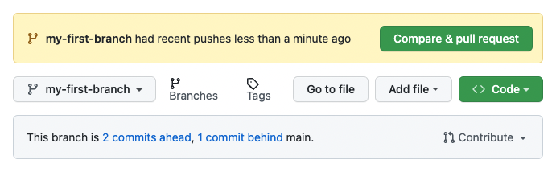

## Step 3: Measure your spec against the gap log

Your change is valid, @{{ login }}! But would it have saved the 2025 project? The team kept a gap log of every rule that surfaced late. Now measure your questions and requirements against it, close one gap you missed, and share the result in a pull request.

### 📖 Theory: A retro-spec and four moves

A **retro-spec** writes the spec a past project should have had, then compares it with what actually surfaced late. Four moves catch most gaps before build:

| Move | What it does |
| --- | --- |
| Clarify | Ask the product owner the questions the epic leaves open. |
| Make it testable | Write exception scenarios for what can go wrong. |
| Quality checklist | Review the spec for missing roles, people and data. |
| Plan | Find dependencies on partners and other teams early. |

In 2025, build ran in weeks 1 to 8, acceptance testing in weeks 9 to 11, and the first groups went live in week 12. Six of the eight gaps surfaced in testing or after go-live. The costs in this step are illustrative, not measured.


### ⌨️ Activity 1: Compare your spec with the gap log

1. Predict: how many of the eight gaps would your questions and requirements have caught? Note the number.

1. In your codespace, create `retro/gap-comparison.md` with this table.

   ```markdown
   # Gap comparison

   | # | Gap | Week found | Move that would catch it | Caught by |
   | --- | --- | --- | --- | --- |
   | 1 | No named approver | 6 | Quality checklist | |
   | 2 | Partner's file layout | 7 | Plan | |
   | 3 | Dependents | 9 | Quality checklist | |
   | 4 | New-hire waiting period | 10 | Clarify | |
   | 5 | Lead time | 12 | Clarify | |
   | 6 | Administrator readiness | 12 | Make it testable | |
   | 7 | Group ends before go-live | 14 | Make it testable | |
   | 8 | Mid-year additions | 15 | Clarify | |
   ```

1. For each row, fill the **Caught by** cell, before the last `|`, with one of these:

   - The name of the requirement in your delta that states the rule, such as `Setup lead time`.
   - A question number from `retro/questions.md`, such as `Q4`, when you asked for the rule but no requirement states it yet.
   - `Missed`, when neither your questions nor your requirements cover it.

   > 💡 **Tip:** Be strict. A requirement catches a gap only if a team that built it wrong would fail one of its scenarios.

1. Compare your count with your prediction. Then check your step 1 prediction: the first gaps in production surfaced in week 12, in Story 1 (lead time) and Story 3 (administrator readiness).

   <details>
   <summary>What each gap cost in 2025 (illustrative)</summary>

   1. **No named approver:** a package reached testing with the wrong frames allowance. 3 days of rework.
   1. **Partner's file layout:** Fabrikam's file had no code for the new rider, and its change window held up file testing. 10 days of waiting and 2 days of rework.
   1. **Dependents:** dependents were missing from the eligibility file. 4 days of rework.
   1. **New-hire waiting period:** new hires showed as covered before their medical started. 3 days of rework.
   1. **Lead time:** a group's rider started 12 days after its request, before setup was done. 6 days of rework and one group's claims reprocessed.
   1. **Administrator readiness:** Fabrikam rejected the first live file, and providers could not find members for 4 days. 8 days of rework and about 60 member calls.
   1. **Group ends before go-live:** a terminated group stayed on Fabrikam's file. 3 days of rework.
   1. **Mid-year additions:** July starters got half allowances, and their claims were adjusted. 5 days of rework and about 40 claims adjusted.

   </details>

<details>
<summary>Having trouble? 🤷</summary><br/>

- **Not sure whether a requirement catches a gap:** Read its scenarios. If none of them would fail when the rule is built wrong, write the question number or `Missed` instead.

- **The table looks broken in the preview:** Each row needs six `|` characters, one at each end and four between the cells.

</details>

### ⌨️ Activity 2: Close a gap and open a pull request

1. Pick one row you marked `Missed`. If none, pick gap 2, **Partner's file layout**: none of the product owner's answers covered it, so it is easy to miss.

1. Add a requirement for it to `openspec/changes/add-vision-rider/specs/vision-rider/spec.md`, under `## ADDED Requirements`, with at least one scenario. The gap log is now your source, so the rule must trace to what happened. You can ask Copilot for a draft as in step 2, then review it with the same checklist.

1. In `retro/gap-comparison.md`, write the new requirement's name in that row's **Caught by** cell. Then add this section at the end of the file and replace both placeholders.

   ```markdown
   ## Added after the retro

   - **Gap number:** <n>
   - **Requirement:** <exact requirement name>
   ```

   > 💡 **Tip:** Copy the name exactly as it appears after `### Requirement:` in the delta.

1. Run `npx openspec validate add-vision-rider --strict` again and fix any errors.

1. Save, commit with your own message, and push to `vision-retro`.

1. In your browser, go to your repository, `{{ full_repo_name }}`. Open the **Pull requests** tab and [create a pull request](https://docs.github.com/en/pull-requests/collaborating-with-pull-requests/proposing-changes-to-your-work-with-pull-requests/creating-a-pull-request) with `main` as the base branch and `vision-retro` as the compare branch.

   > 💡 **Tip:** If a **Compare & pull request** banner appears for `vision-retro`, you can use it instead.

   

1. Give it a short title, such as `Retro-spec for the vision rider`, and create the pull request.

1. Wait a moment for Mona to check your work, provide feedback, and share the next lesson.

<details>
<summary>Having trouble? 🤷</summary><br/>

- **Mona says a row has no Caught by value:** Fill every row from 1 to 8. If nothing catches a gap, write `Missed`.

- **Mona can't find the requirement:** Copy the name exactly from the `### Requirement:` heading in the delta, without the `### Requirement:` part, and replace the `<n>` placeholder with the gap number.

- **Mona says validation failed:** Run `npx openspec validate add-vision-rider --strict` and fix every error. A new requirement needs MUST or SHALL in its rule text and a `#### Scenario:`.

- **You changed something after opening the pull request:** Commit and push to `vision-retro` again. Mona checks the pull request again on every push.

- **Mona did not respond:** Check that the pull request targets `main`. You can watch the run in the [Actions tab](https://github.com/{{ full_repo_name }}/actions).

</details>
