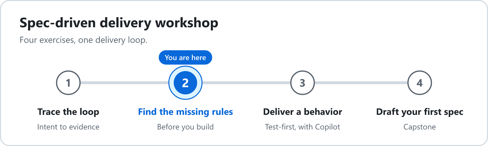

## Review

_Congratulations, you've completed this exercise and learned how to question an epic, turn the answers into testable requirements with exception scenarios, and measure which late gaps a spec would have caught!_

Here's a recap of what you accomplished:

- You questioned a thin epic through five lenses and kept only the questions that ask for a rule.
- You turned the product owner's answers into a valid OpenSpec change, reviewed Copilot's draft against the answers, and kept only rules you could trace.
- You measured your spec against eight late gaps, closed one you missed, and shared the result in a pull request.

Your pull request stays open for your team to read. You can merge it or close it; the exercise is complete either way.

### Check your understanding

Try to answer from memory before you peek. Recalling is what makes it stick.

Four gaps surfaced after go-live. Which lenses would have found them?
 

**When?** found the lead time and mid-year additions, **What proves it is ready?** found administrator readiness, and **What stops or undoes it?** found the group that ended before go-live. Those lenses find the most expensive gaps, because their rules only show up when something goes wrong.

Your change passes <code>openspec validate --strict</code>. Does that prove each rule is right?
 

No. Strict validation checks the format: delta headings, MUST or SHALL, and at least one scenario per requirement. Only people can check that each rule matches what the product owner decided.

Copilot's draft includes a plausible rule that no answer states. What do you do?
 

Delete it, or turn it into a question for the product owner. A rule nobody decided is a guess, even when it reads well.

### Take it to your work

Pick an epic in your team's backlog before its next refinement. Write five questions, one for each lens, and bring them to the product owner.

### What's next?

- Continue with exercise 3, **Deliver an Approved Behavior with Copilot**, where you build one approved behavior from its spec and scenarios.
- Read [Writing specs](https://github.com/Fission-AI/OpenSpec/blob/main/docs/writing-specs.md) in the OpenSpec documentation to learn more about requirements and scenarios.
- Explore more [GitHub Skills exercises](https://learn.github.com/skills).
