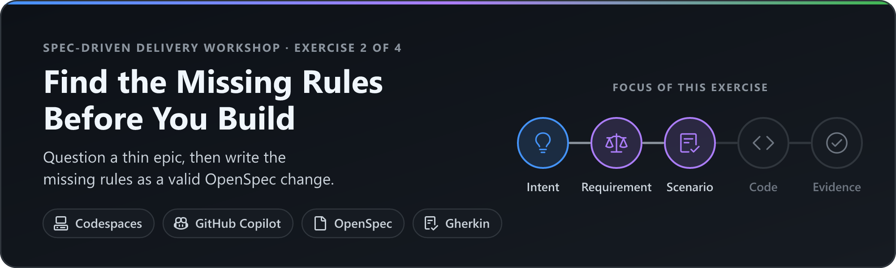
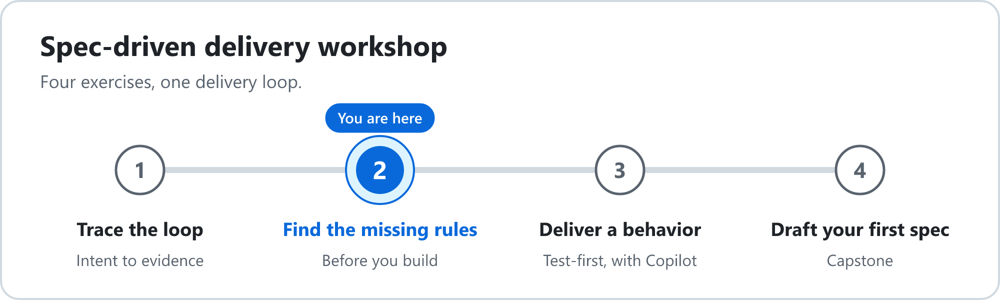

# Find the Missing Rules Before You Build

_Replay a real-looking epic, ask the questions it never answered, and catch missing rules before anyone builds._

## Welcome

- **Who is this for**: Product owners, business analysts, testers, developers and architects who finished **Trace the Loop from Intent to Evidence**, or who can already read an OpenSpec requirement and its scenarios.
- **What you'll learn**: How clarifying questions and exception scenarios turn an epic into testable requirements, and how to measure which late-found gaps a spec would have caught.
- **What you'll build**: A validated OpenSpec change and a gap comparison, shared in a pull request.
- **Prerequisites**:
  - Comfort with branches, commits and pull requests. If they are new to you, start with [Introduction to GitHub](https://github.com/skills/introduction-to-github).
  - Access to [GitHub Codespaces](https://docs.github.com/en/codespaces/overview). Personal accounts include monthly free usage. If you can't use Codespaces, work in VS Code on your computer instead: see the workshop's [local setup guide](https://github.com/samueltauil/spec-driven-delivery-workshop/blob/main/local-setup.md).
  - [GitHub Copilot](https://github.com/features/copilot) with Copilot Chat. Copilot Free works, but its monthly allowance is limited, and the full workshop uses many prompts.
- **How long**: This exercise takes less than 50 minutes to complete.

In this exercise, you will:

1. Question a real-looking epic through five lenses before you see any answers.
1. Turn the product owner's answers into a validated OpenSpec change with exception scenarios.
1. Measure your spec against the gaps found late in 2025, close one, and open a pull request.

This is exercise 2 of 4 in the **Spec-Driven Delivery with OpenSpec, Gherkin and GitHub Copilot** workshop. All organizations, people and data in it are fictional.

### How to start this exercise

Simply copy the exercise to your account, then give your favorite Octocat (Mona) **about 20 seconds** to prepare the first lesson, then **refresh the page**.

Having trouble? 🤷
 

When copying the exercise, we recommend the following settings:

- For owner, choose your personal account or an organization to host the repository.

- We recommend creating a public repository, since private repositories will use Actions minutes.

If the exercise isn't ready in 20 seconds, please check the [Actions](../../actions) tab.

- Check to see if a job is running. Sometimes it simply takes a bit longer.

- If the page shows a failed job, please submit an issue. Nice, you found a bug! 🐛

---

&copy; 2026 acworkma &bull; [Code of Conduct](https://www.contributor-covenant.org/version/2/1/code_of_conduct/code_of_conduct.md) &bull; [MIT License](https://gh.io/mit)
